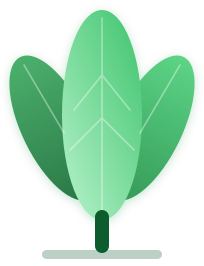

# Sprout AAC brand assets

The **three-leaf sprout** is the official Sprout AAC logo. It's used for the app icon, the website ([sproutaac.org](https://sproutaac.org)), and the [LinkedIn page](https://www.linkedin.com/company/sproutaac/). Use these files rather than redrawing it. A public version of this guide is at **[sproutaac.org/brand](https://sproutaac.org/brand)**.

## Logo

| File | What it's for |
| --- | --- |
| `sprout-mark.svg` | **Master.** Vector, sharp at any size. Edit this file, then regenerate everything else from it. |
| `sprout-mark.png` | Transparent PNG (393×512) for places that can't take SVG. |
| `sprout-mark-on-white-400.png` | Square, on white. For avatars (LinkedIn page, GitHub org, Discord). |
| `sprout-logo-lockup-original.png` | The original 960×320 raster the vector was redrawn from. Kept for reference only. |

On dark or green backgrounds, give the mark a soft mint glow (see the social templates). Its darker side leaves need the separation there.

## App icon

| File | What it's for |
| --- | --- |
| `app-icon/app-icon-1024.png` | Full-bleed square on cream `#FAF7F2`. Source for iOS and Android; the OS applies its own rounded mask. |
| `app-icon/app-icon-macos-1024.png` | macOS-style rounded tile with margin and shadow, on a transparent canvas. |
| `app-icon/template.html` | Source for both (`?shape=square` / `?shape=macos`). |

## Social images

| File | Size | Use |
| --- | --- | --- |
| `social/og-image-1200x630.png` | 1200×630 | Link previews for sproutaac.org (the site's `og-image.png`) |
| `social/linkedin-page-cover-1128x191.png` | 1128×191 (rendered at 2×) | LinkedIn company page cover |
| `social/linkedin-profile-banner-1584x396.png` | 1584×396 | LinkedIn personal profile banner |

Each image has an HTML source in `social/templates/`. To change one, edit the HTML and re-render it at the listed size with a headless browser (Chromium/Playwright screenshot of the page). The templates load Lora and DM Sans from Google Fonts.

## Colours

These match the website's CSS tokens.

| Token | Hex | Use |
| --- | --- | --- |
| `--forest` | `#0F5C2E` | Primary dark green, text on light backgrounds |
| `--green` | `#1A8C45` | Primary brand green |
| `--mid` | `#3DC46A` | Leaf green, accents |
| `--fresh` | `#A8F0C0` | Light mint, highlights on dark green |
| `--cream` | `#FAF7F2` | Page and app-icon background |

## Typography

- **Lora** (600/700) for headings and the wordmark
- **DM Sans** (400–700) for body text and UI
